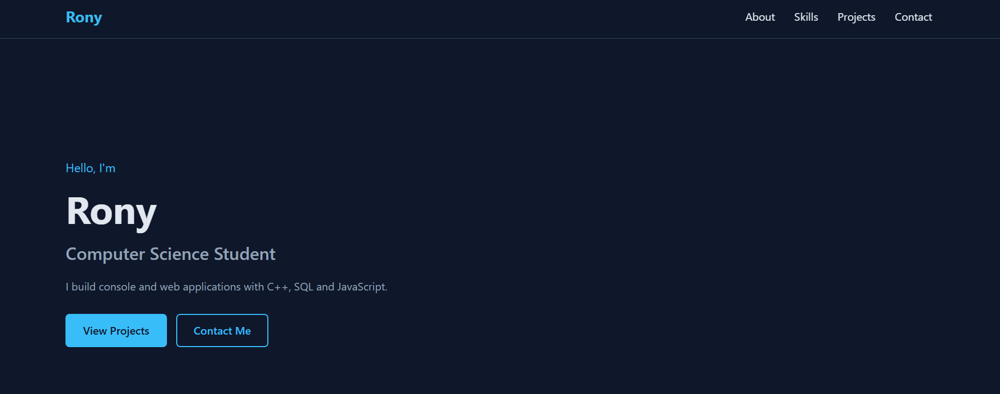

# Personal Portfolio Website

A responsive personal portfolio website built with HTML, CSS and JavaScript.

## Features

- Responsive layout with a mobile menu
- Smooth scrolling navigation
- Scroll reveal animations
- Sections for About, Skills, Projects and Contact

## Technologies Used

- HTML5
- CSS3 (Flexbox, Grid, media queries)
- JavaScript (DOM, IntersectionObserver)

## How to Run

1. Clone the repository
2. Open index.html in any web browser

## Author

Rony - https://github.com/Rony60031
