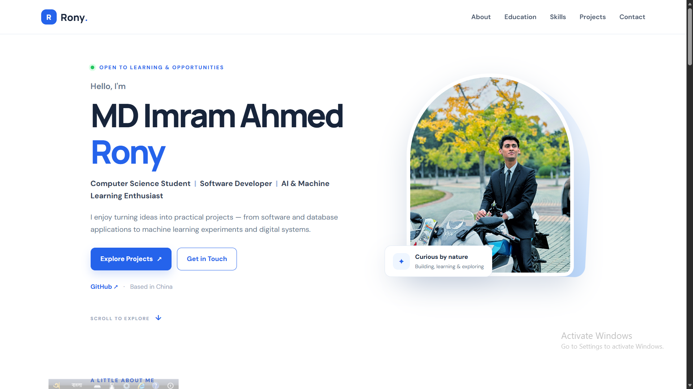
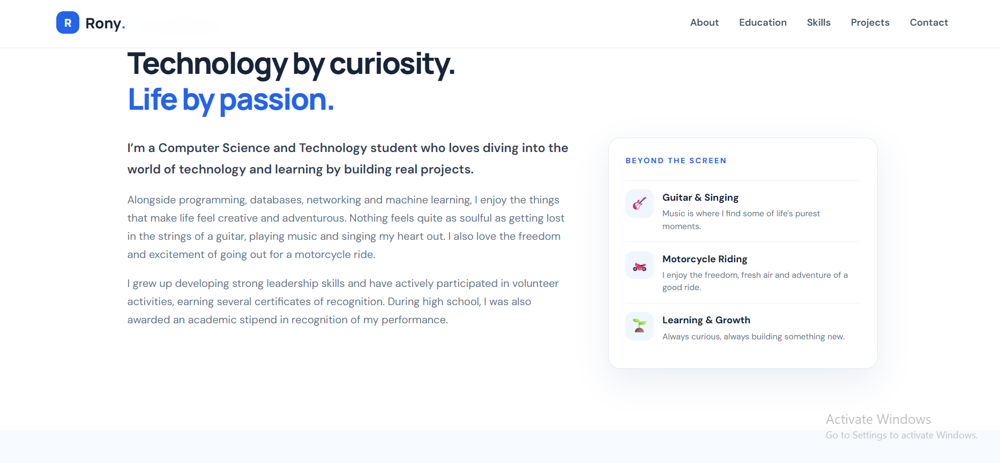
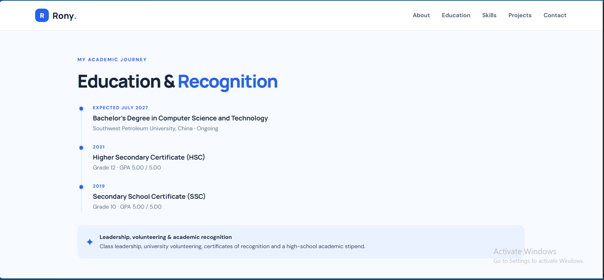
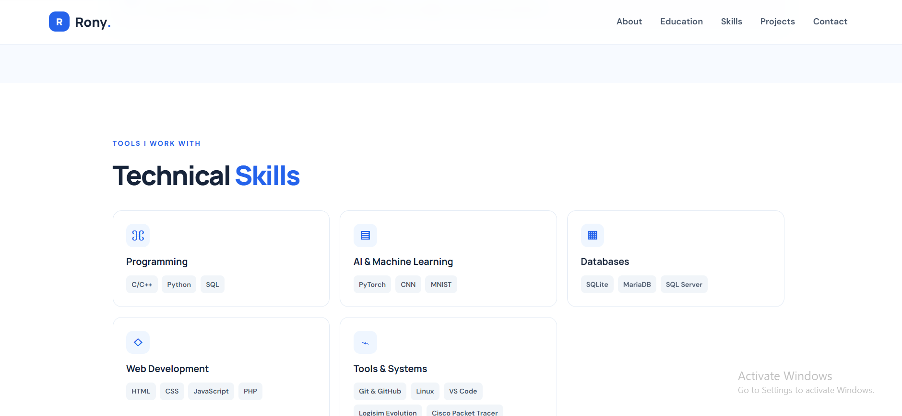
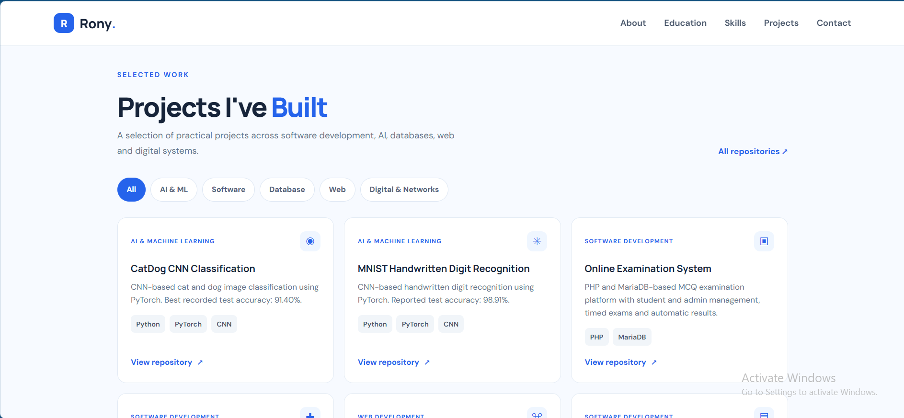
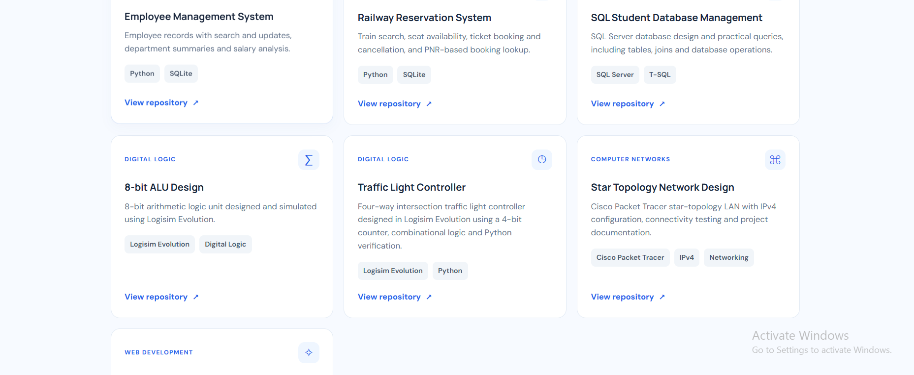
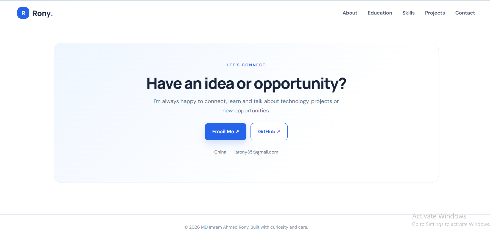

# Personal Portfolio Website

A responsive personal portfolio website built with HTML, CSS and JavaScript.

## Features

- Responsive layout with a mobile menu
- Smooth scrolling navigation
- Scroll reveal animations
- Sections for About, Skills, Projects and Contact

## Technologies Used

- HTML5
- CSS3 (Flexbox, Grid, media queries)
- JavaScript (DOM, IntersectionObserver)

## How to Run

1. Clone the repository
2. Open index.html in any web browser

## Author

Rony - https://github.com/Rony60031

## Portfolio Screenshots

### Home / Hero

### About Me

### Education and Achievements

### Technical Skills

### Projects

### Contact

## Live Website

[Visit the live portfolio](https://rony60031.github.io/personal-portfolio/)

[View the source code on GitHub](https://github.com/Rony60031/personal-portfolio)
